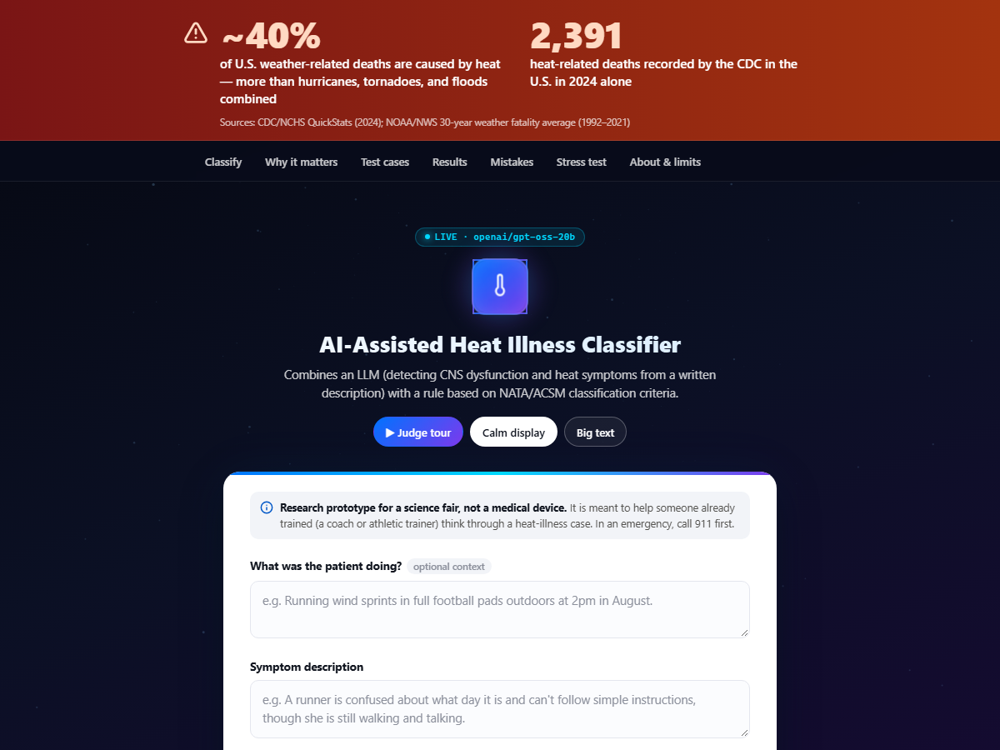
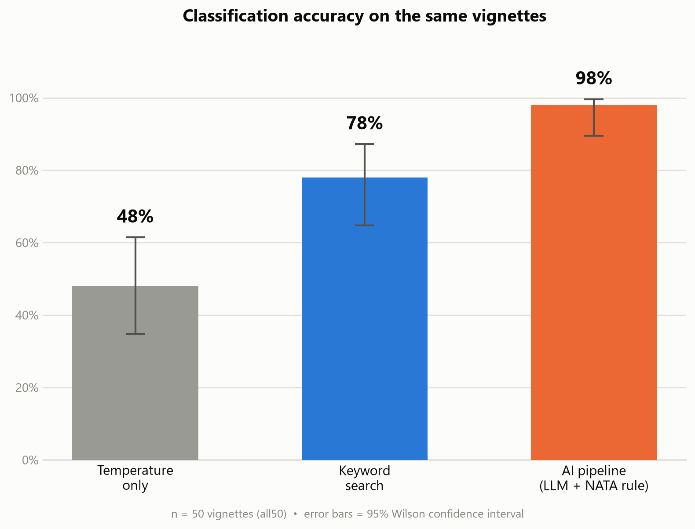
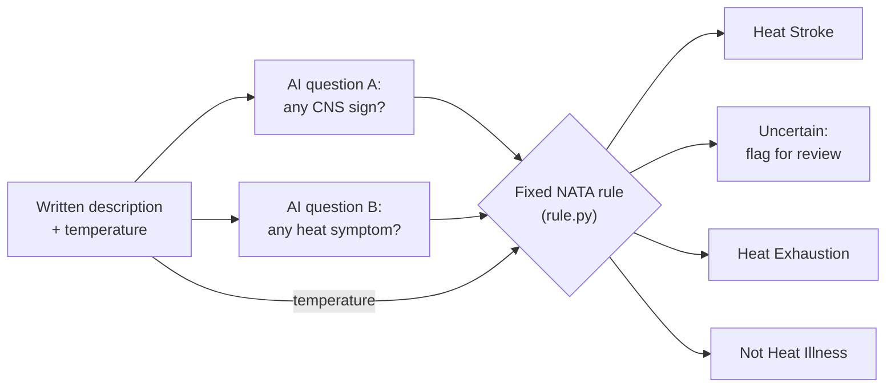
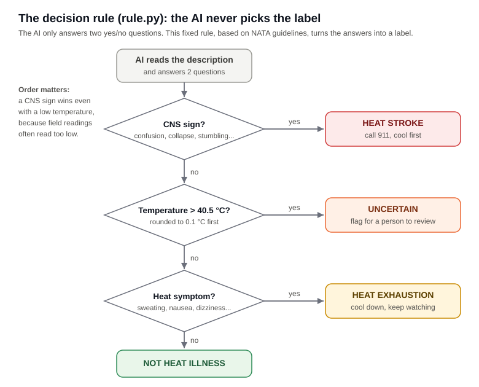
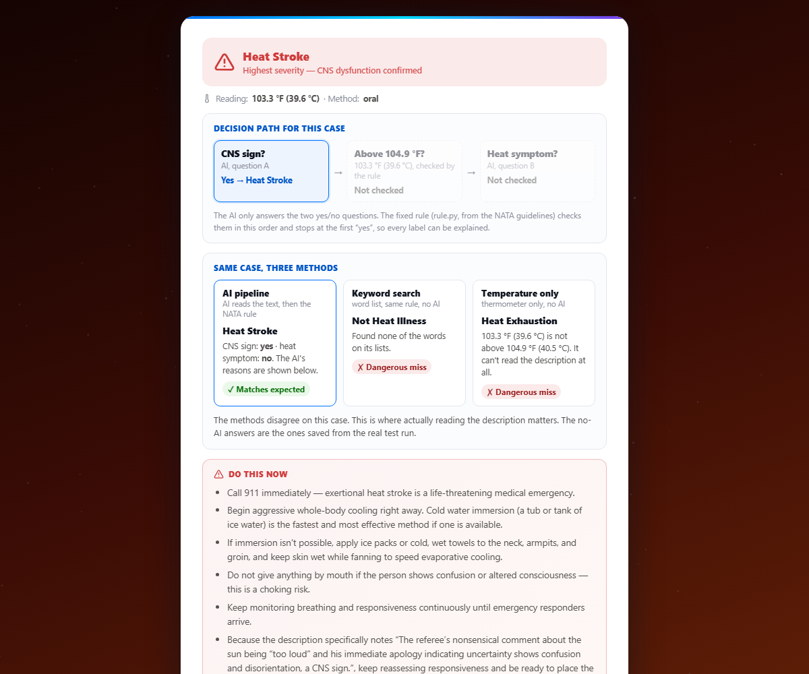
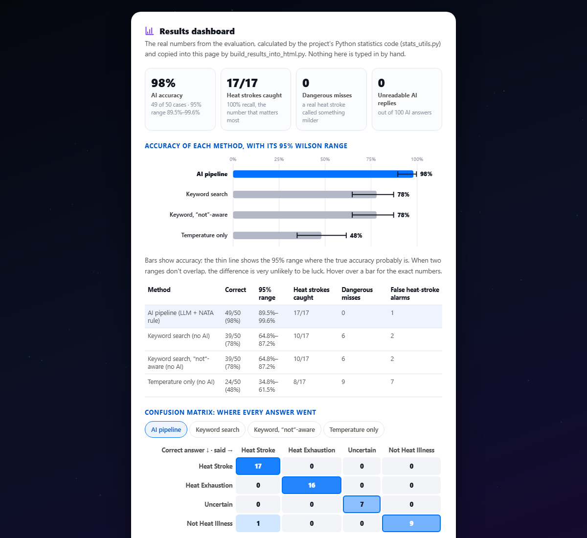
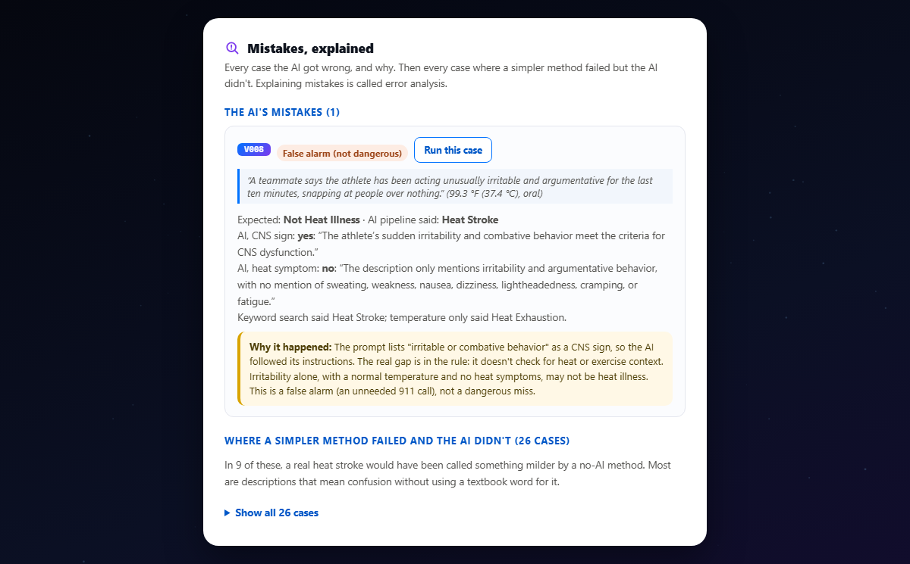

# 🌡️ AI-Assisted Heat Illness Classifier

**Can an AI that reads a written description of a person tell heat stroke apart from heat exhaustion more accurately than simpler methods?**


**By Reyansh Singh** · State Science and Engineering Fair (SSEF) project, Junior Division



> [!IMPORTANT]
> This is a student science fair research prototype, **not a medical device**. It was tested only on written, fictional cases. In an emergency, call 911.

---

## Contents
- [Why this matters](#why-this-matters)
- [Results at a glance](#results-at-a-glance)
- [How it works](#how-it-works)
- [The web app](#the-web-app)
- [Quick start](#quick-start)
- [Repository structure](#repository-structure)
- [The experiment](#the-experiment)
- [Safety design](#safety-design)
- [Limitations](#limitations)
- [Where AI was used](#where-ai-was-used)
- [Documentation](#documentation)
- [References](#references)

---

## Why this matters

**Heat stroke** is a life-threatening emergency; **heat exhaustion** is much less serious. Telling them apart quickly matters, and it's harder than it sounds:

- The key sign of heat stroke is a problem with the brain and nerves (a **CNS sign**), such as confusion, stumbling or collapse. People describe these signs in everyday words ("says the sun is too loud") that a simple word search misses.
- Temperatures taken in the field (mouth, ear, forehead) often read **lower** than the body's real core temperature, so a thermometer alone can make a real heat stroke look milder.

| | |
|---|---|
| **~40%** | of U.S. weather-related deaths are caused by heat, more than hurricanes, tornadoes and floods combined (NOAA/NWS 30-year average, 1992–2021) |
| **2,391** | heat-related deaths recorded by the CDC in the U.S. in 2024 (CDC/NCHS) |
| **~5×** | more U.S. deaths are affected by heat (about 9,000 a year) than official records count (about 1,700), because heat often isn't written on the death certificate (NPR and Boston University, 2026) |

## Results at a glance

All 50 test cases, run on October 17, 2026 (model `openai/gpt-oss-20b`, temperature 0, prompt version `v2_expanded`):

| Method | Accuracy | 95% Wilson range | Real heat strokes caught | Dangerous misses |
|---|---|---|---|---|
| **AI pipeline (LLM + NATA rule)** | **49/50 = 98%** | **89.5% – 99.6%** | **17 of 17** | **0** |
| Keyword search (no AI) | 39/50 = 78% | 64.8% – 87.2% | 10 of 17 | 6 |
| Temperature only (no AI) | 24/50 = 48% | 34.8% – 61.5% | 8 of 17 | 9 |

- **McNemar's test:** the AI and keyword search disagreed on 10 cases and the AI was right on all 10 (**p = 0.002**). Against temperature only, the AI won all 25 disagreements (**p < 0.0001**).
- **The ranges don't overlap**, so the AI's lead is very unlikely to be luck.
- **Dangerous miss** = a real heat stroke called heat exhaustion or "not heat illness". The AI had **0**.
- **Its one mistake (V008)** was a false alarm, not a dangerous miss. See [The experiment](#error-analysis-the-one-mistake).



## How it works

The AI is **not** asked for a diagnosis. It answers two narrow yes/no questions, and a fixed rule based on the NATA guidelines picks the label.



The rule checks in this order and stops at the first "yes":

| # | Check | Label |
|---|---|---|
| 1 | CNS sign found | **Heat Stroke**, even at a low temperature (NATA: *cool first, transport second*) |
| 2 | Temperature above 40.5 °C (104.9 °F) with no CNS sign | **Uncertain: flag for review** (a trained person decides) |
| 3 | Heat symptom found | **Heat Exhaustion** |
| 4 | None of the above | **Not Heat Illness** |



**Why a rule instead of letting the AI decide?** A rule is predictable, testable and explainable: every label can be traced to exactly why it was chosen. Temperatures are rounded to 0.1 °C first, so exactly 40.5 °C is *not* above the line, but 105.0 °F (40.56 °C → 40.6 °C) *is*.

## The web app

A Flask web app runs the **exact same Python classifier that was tested**, so the 98% describes the real app. The Groq API key stays on the laptop and never reaches the browser.

<table>
<tr>
<td width="50%"></td>
<td width="50%"></td>
</tr>
<tr>
<td align="center"><b>A result:</b> decision path and three methods side by side</td>
<td align="center"><b>Results dashboard:</b> accuracy, ranges and confusion matrix</td>
</tr>
</table>

**Features**

| Feature | What it does |
|---|---|
| **Safety first** | A Heat Stroke result opens with "1. Call 911, 2. Start cooling now", a 30-minute cooling timer and a "Copy note for EMS" button. "Uncertain" tells you to get a trained person. |
| **Decision path** | Shows which of the rule's checks ran for this case and where it stopped. |
| **Same case, three methods** | The AI pipeline, keyword search and temperature only on the same input, with the word that triggered the keyword search. |
| **Results dashboard** | Accuracy chart with Wilson ranges, a confusion matrix for each method, McNemar's test, consistency and expert agreement. Built from the real result files; nothing typed by hand. |
| **Mistakes, explained** | Every AI mistake with the AI's own reasons and a "why" note, plus every case a simpler method got wrong that the AI got right. |
| **Stress test** | Changes a case in small ways (typos, all caps, an unrelated sentence, the other temperature unit, a denial sentence, an added CNS sign) and checks whether each method's answer holds. |
| **About & limits** | Intended use, what it's not for, known limits and where AI was used. |
| **Judge tour** | A 7-step guided walkthrough that runs offline in demo mode. |
| **Demo mode** | Replays the real saved AI answers for the 50 test cases, with no internet or API key. |
| **Offline chatbot** | A Naive Bayes model written from scratch answers questions about a result, choosing only from pre-written answers. |
| **Fahrenheit first** | Temperatures are typed and explained in °F, with the Celsius the rule uses shown alongside. |
| **Calm display, Big text, phone layout** | For a quieter screen, a phone outside, or a judge standing back. |



## Quick start

**You need:** Windows, macOS or Linux with [Python 3](https://www.python.org/downloads/) (built and tested with Python 3.13). A free [Groq API key](https://console.groq.com/keys) is only needed for live AI answers; demo mode works without one.

**1. Get the code and install the packages**
```bash
git clone https://github.com/singh-reyansh/heat-illness-classifier.git
cd heat-illness-classifier
python -m pip install -r requirements.txt
```
On Windows you can type `py` instead of `python`.

**2. Run the web app**
```bash
python server.py
```
Open **http://localhost:5000**. Without a key, tick **Demo mode** or click **Judge tour**: the 50 test cases, results, mistakes and comparisons all work offline.

**3. For live AI answers, set your key first** (it is read from an environment variable and never saved in a file):

| Terminal | Command |
|---|---|
| Windows PowerShell | `$env:GROQ_API_KEY="your_key_here"` |
| Windows Command Prompt | `set GROQ_API_KEY=your_key_here` |
| macOS / Linux | `export GROQ_API_KEY=your_key_here` |

**4. Re-run the experiment** (needs a key)
```bash
python full_classifier_groq.py --set all50 --runs 3
python baseline_classifier.py --set all50
python keyword_classifier.py --set all50
python compare_classifiers.py --set all50
python make_chart.py --set all50
python build_results_into_html.py web/classifier_flask.html
python build_demo_into_html.py web/classifier_flask.html --responses saved_responses_all50.json
```

**5. Run the automatic checks** (no key or internet needed)
```bash
python tests/test_all.py
python tests/test_runner_mock.py
```

More detail: [running the experiment](docs/RUNNING_THE_EXPERIMENT.md) · [running the web app](docs/RUNNING_THE_WEB_APP.md).

## Repository structure

```text
heat-illness-classifier/
│
├── README.md                       ← you are here
├── requirements.txt                ← Python packages to install
│
│   ── The classifier ──
├── prompts.py                      ← the exact two yes/no questions sent to the AI
├── rule.py                         ← the NATA decision rule, temperature rounding, caveats
├── full_classifier_groq.py         ← talks to the Groq API; runs a whole test set and saves results
│
│   ── The experiment ──
├── baseline_classifier.py          ← baseline 1: temperature only
├── keyword_classifier.py           ← baseline 2: keyword search (plain and "not"-aware)
├── vignette_sets.py                ← loads the test sets; prints and saves each report
├── compare_classifiers.py          ← side-by-side results, McNemar's test, error analysis
├── stats_utils.py                  ← Wilson interval, confusion matrix, McNemar, Cohen's kappa
├── kappa_agreement.py              ← expert labeling sheet + agreement score
├── make_chart.py                   ← draws the accuracy chart
├── engineering_log.py              ← menu program for design constraints, iterations, success criteria
│
│   ── The web app ──
├── server.py                       ← Flask server: /api/classify, /api/baselines, /api/chat
├── build_results_into_html.py      ← copies the real results into the page
├── build_demo_into_html.py         ← copies the saved AI replies into the page (demo mode)
├── build_vignettes_into_html.py    ← copies the 50 test cases into the page
├── app.py                          ← older backup app (Streamlit)
├── demo.py                         ← terminal-only version
│
│   ── The chatbot (machine learning written from scratch) ──
├── naive_bayes.py                  ← the Naive Bayes model
├── chatbot.py                      ← picks a topic and fills in this case's details
├── chatbot_data.json               ← 14 topics: training questions, test questions, answers
├── compare_with_sklearn.py         ← checks the model against scikit-learn
├── test_chatbot.py                 ← scores the chatbot on unseen questions
├── check_parity.py                 ← checks the older JavaScript page matches the Python code
│
├── web/
│   └── classifier_flask.html       ← the web page
├── data/
│   ├── vignettes_test20.json       ← 20 locked test cases (V001–V020)
│   ├── vignettes_extra30.json      ← 30 more held-out test cases (V021–V050)
│   ├── dev_cases.json              ← 10 practice cases, the only ones used to try prompt wording
│   └── engineering_log.json        ← engineering design log data
├── results/
│   ├── *_results_all50.csv         ← every case, every method
│   ├── saved_responses_all50.json  ← all 100 real AI prompts and replies
│   ├── run_metadata_all50.json     ← model, date, settings, number of API calls
│   └── accuracy_chart_all50.png
├── docs/
│   ├── PROJECT_GUIDE.md            ← the complete guide: every concept and file explained
│   ├── RUNNING_THE_EXPERIMENT.md
│   ├── RUNNING_THE_WEB_APP.md
│   ├── images/                     ← diagrams and app screenshots
│   └── reports/                    ← project report, conclusion, evaluation answers, SSEF Form 2A
├── legacy/
│   └── classifier_for_sharing.html ← older page that called the AI from the browser
└── tests/
    ├── test_all.py                 ← edge cases, statistics formulas, web routes
    └── test_runner_mock.py         ← the whole pipeline against a fake AI server
```

## The experiment

### Test cases (vignettes)
A **vignette** is a short written patient story with a known correct answer. Real heat stroke patients can't safely or privately be used for a student project, and written cases let every method take the exact same test, including tricky edge cases on purpose.

| Set | Cases | Used for |
|---|---|---|
| `dev` | 10 (V101–V110) | The **only** place prompt wording was tried out |
| `test20` | 20 (V001–V020) | Locked test set |
| `extra30` | 30 (V021–V050) | Second held-out test set |
| `all50` | 50 | Both test sets together |

**The golden rule:** the prompt wording was locked **before** any test score was seen. Changing prompts after seeing which test cases failed would be like studying the answer key before an exam.

### Baselines
A **baseline** is a simpler method the AI has to beat.
- **Temperature only:** above 40.5 °C → Heat Stroke, otherwise Heat Exhaustion. It can't read the description.
- **Keyword search:** looks for words like "confus" or "collaps", then uses the **same rule** as the AI. This is the fair comparison, because only the "reading" part differs. Its word lists were written before seeing any scores.

### Statistics
| Measure | What it answers |
|---|---|
| **Accuracy** (strict exact match) | How many cases got exactly the right label? "Uncertain" counts as its own label. |
| **Wilson 95% interval** | Where the true accuracy probably is, given only 50 cases. Unlike "± margin", it never goes above 100%. |
| **Recall and dangerous misses** | Of the real heat strokes, how many were caught? For heat stroke, a miss is far worse than a false alarm. |
| **McNemar's test** | Both methods took the same test, so only the cases where they disagree show which is better. |
| **Cohen's kappa** | Does an independent expert agree with the answer key beyond luck? *(In progress.)* |
| **Consistency** | Does the AI give the same answer when asked again? *(Next step: `--runs 3`.)* |

All formulas are written from scratch with worked examples in [stats_utils.py](stats_utils.py) and explained in the [project guide](docs/PROJECT_GUIDE.md#5-part-3-the-statistics-explained).

### Error analysis: the one mistake
> **V008:** "A teammate says the athlete has been acting unusually irritable and argumentative for the last ten minutes, snapping at people over nothing." 99.3 °F (37.4 °C).

- **Correct answer:** Not Heat Illness. **The pipeline said:** Heat Stroke.
- **Why:** the prompt lists irritable or combative behavior as a CNS sign, so the AI followed its instructions. The real gap is in the rule: it doesn't check for heat or exercise context.
- **Dangerous?** No. It's a false alarm (an unneeded 911 call). Missing a real heat stroke would be dangerous, and that happened 0 times.

## Safety design
- The AI **never writes medical advice** and never picks the label. It only answers yes/no.
- The label comes from a **fixed rule** based on the NATA 2015 position statement.
- Every first-aid step and chatbot answer is **pre-written**; keywords and the chatbot only choose *which* one to show.
- For heat stroke, the page leads with "call 911" and cooling, and the chatbot stays locked until the user confirms they called.
- "Uncertain" sends hard cases to a trained person instead of guessing.
- The API key stays on the server and is never sent to the browser or saved in a file.

## Limitations
1. **Written stories, not real patients.** Real descriptions are messier.
2. **The student wrote the answer key.** An independent expert check (Cohen's kappa) is the most important next step.
3. **50 cases is a small test**, which is why every accuracy comes with a 95% range.
4. **Run once so far.** Repeatability across runs hasn't been measured yet.
5. **The rule doesn't check heat or exercise context** (the V008 mistake). Other causes of confusion, like a concussion or low blood sugar, can look similar.
6. **AI models change.** Groq retires models over time, so the exact model and date are saved with every run.

## Where AI was used
- **In the experiment:** the Groq API (`openai/gpt-oss-20b`, temperature 0) answers the two yes/no questions. The full log of all 100 prompts and replies is in [results/saved_responses_all50.json](results/saved_responses_all50.json).
- **Not used for:** choosing the label, writing first-aid steps or chatbot answers, creating the answer key, or analyzing the statistics. It only ever sees fictional cases.
- **The chatbot** is not a language model. It's a Naive Bayes classifier written and trained from scratch.
- **Full disclosure**, including other AI help received while building the project, is in the [SSEF Form 2A attachment](docs/reports/SSEF_Form2A_Groq_AI_Disclosure_and_Prompt_Log.docx).

## Documentation
| Document | What's in it |
|---|---|
| [Project guide](docs/PROJECT_GUIDE.md) | The complete explanation: every concept, every statistic, every file, a glossary and likely judge questions |
| [Running the experiment](docs/RUNNING_THE_EXPERIMENT.md) | The order of steps that keeps the test honest |
| [Running the web app](docs/RUNNING_THE_WEB_APP.md) | Setup, keys, demo mode, troubleshooting |
| [Project report](docs/reports/Heat_Illness_Project_Report_Reyansh.docx) | The written report |
| [Conclusion](docs/reports/Project_Conclusion_Reyansh.docx) | Conclusion |
| [Evaluation answers](docs/reports/Project_Evaluation_Answers_Reyansh.docx) | Answers to the project evaluation questions |
| [SSEF Form 2A attachment](docs/reports/SSEF_Form2A_Groq_AI_Disclosure_and_Prompt_Log.docx) | AI-use disclosure and prompt log |

## References
- Casa DJ, DeMartini JK, Bergeron MF, et al. *National Athletic Trainers' Association Position Statement: Exertional Heat Illnesses.* Journal of Athletic Training. 2015;50(9):986–1000.
- CDC / National Center for Health Statistics. QuickStats: heat-related deaths in the United States (2024).
- NOAA / National Weather Service. Weather fatality statistics, 30-year average (1992–2021).
- Borunda A. [NPR spent 2 years tracking deaths from heat. We found a staggering hidden toll.](https://www.npr.org/2026/08/31/nx-s1-5724225/heat-wave-death-toll-tracker) NPR, August 31, 2026 (analysis with Boston University).

---

<sub>Student science fair research prototype. Not a medical device and not medical advice. In an emergency, call 911.</sub>
