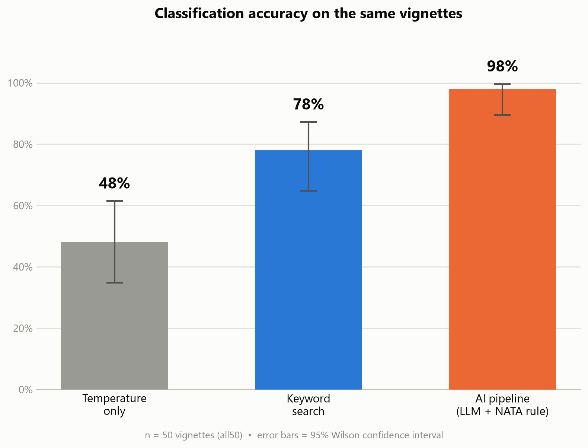
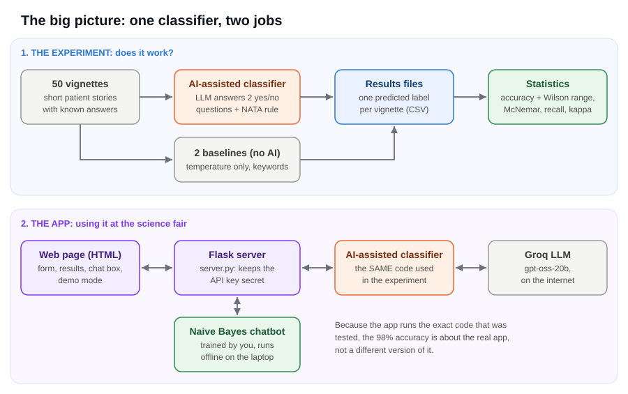
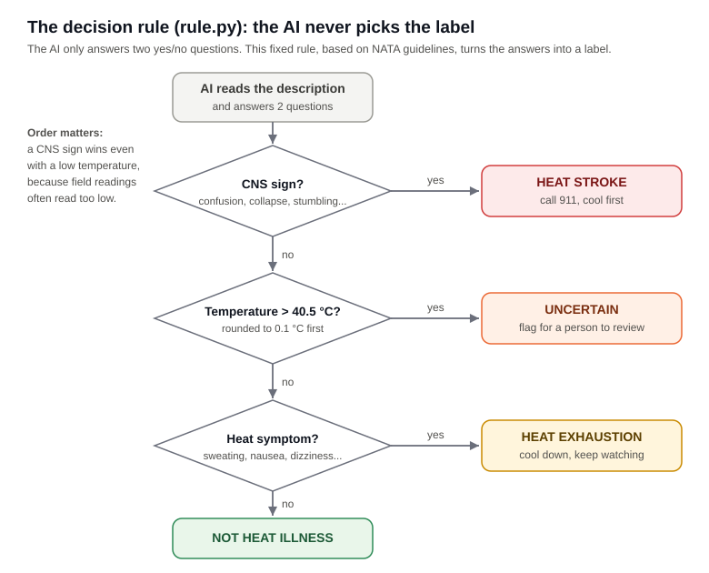
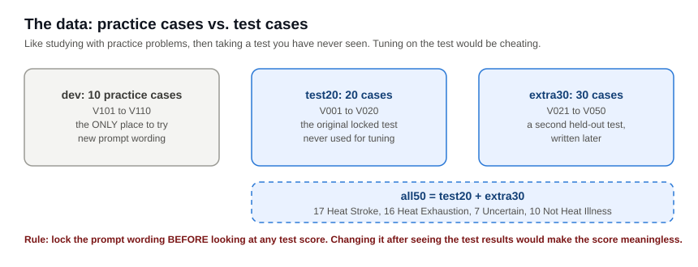
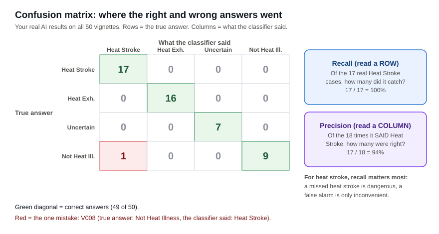
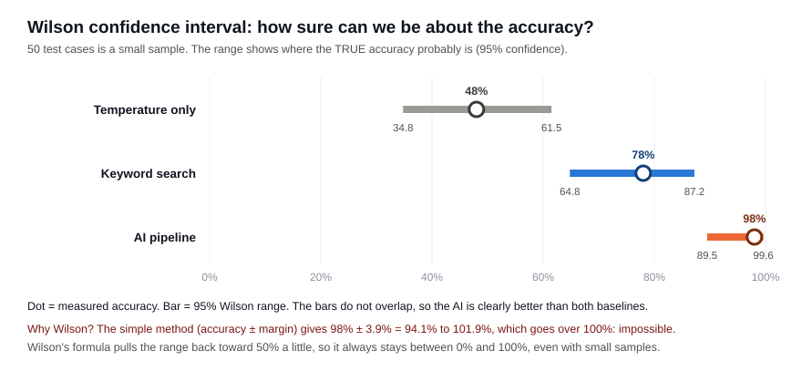
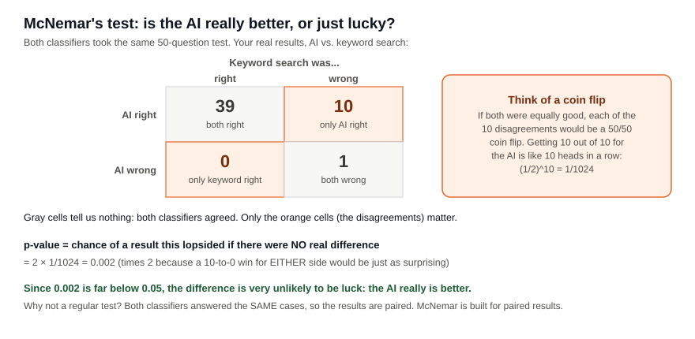
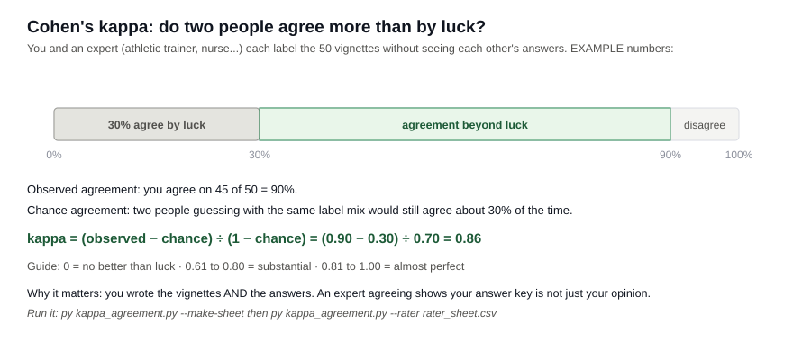
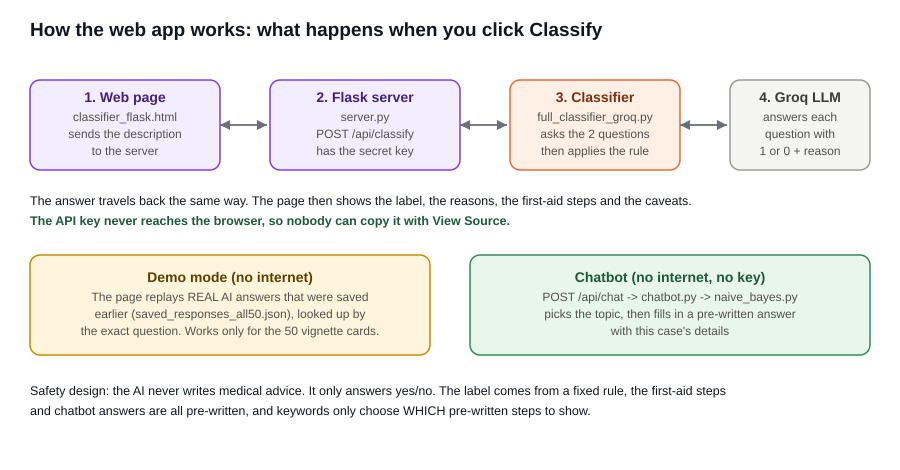
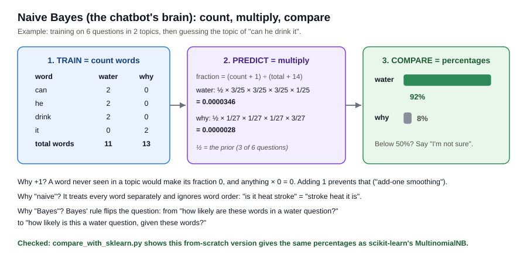

# AI-Assisted Heat Illness Classifier: The Complete Guide

This guide explains the whole project: the big idea, how every part works, every statistics concept, and what every file does. The pictures are in `docs/images/`. To run things, see [README_HOW_TO_RUN.md](RUNNING_THE_EXPERIMENT.md) (the experiment) and [HOW_TO_RUN_FLASK.md](RUNNING_THE_WEB_APP.md) (the web app).

---

## 1. The question and the answer

**The question:** Can an AI that reads a written description of a person tell **heat stroke** apart from **heat exhaustion** more accurately than simpler methods?

**Why it matters:** heat stroke is a life-threatening emergency, while heat exhaustion is less serious. The most important sign of heat stroke is a problem with the brain and nerves (a **CNS sign**), such as confusion or collapse. A thermometer alone often misses it, because temperatures taken by mouth, ear or forehead usually read lower than the body's real core temperature.

**The answer (real results, all 50 test vignettes, one run on Oct 17, 2026):**

| Method | Accuracy | 95% Wilson range | Real heat strokes caught | Dangerous misses |
|---|---|---|---|---|
| AI pipeline (LLM + NATA rule) | **49/50 = 98%** | 89.5% to 99.6% | **17 of 17** | **0** |
| Keyword search (no AI) | 39/50 = 78% | 64.8% to 87.2% | 10 of 17 | 6 |
| Temperature only (no AI) | 24/50 = 48% | 34.8% to 61.5% | 8 of 17 | 9 |

McNemar's test says the AI's lead is very unlikely to be luck (p = 0.002 vs keyword search).

---

## 2. The big picture

The project has **one classifier** that does **two jobs**:

1. **The experiment**: run the classifier on 50 test stories with known answers, compare it against two simpler methods, and use statistics to show how good it is and how sure we can be.
2. **The app**: a web page that uses the **exact same classifier code**, plus extras for real use: first-aid steps, an offline demo mode, and a chatbot you trained yourself.

Because the app runs the same code that was tested, the 98% describes the real app, not a different version of it.

---

## 3. Part 1: How the classifier works

### 3a. The AI only answers two yes/no questions
The AI (a **large language model**, or LLM, called `gpt-oss-20b`, reached through the Groq API) is **not** asked "what's the diagnosis?". It is asked two narrow questions:

1. **CNS question:** does the description show signs of central nervous system dysfunction, such as confusion, stumbling, strange behavior, collapse or seizure?
2. **Heat question:** does it mention a heat symptom, such as heavy sweating, nausea, dizziness, cramps or fatigue?

Each answer must come back as `Answer: 1 or 0` plus `Reason: one sentence`. This fixed format lets the program read the answer reliably. If the format is wrong, it asks again, up to 2 more times. The exact question text is in [prompts.py](../prompts.py).

**Temperature 0** is a setting that makes the AI as consistent as possible, so the same question gets the same answer.

### 3b. A fixed rule picks the label, not the AI

[rule.py](../rule.py) turns the two answers plus the temperature into a label, checked in order:

1. **CNS sign → Heat Stroke**, even with a low temperature. This follows the NATA (National Athletic Trainers' Association) guidance: field temperatures often read too low, and waiting for a higher number can cost a life. "Cool first, transport second."
2. **Temperature above 40.5 °C with no CNS sign → Uncertain (flag for review).** This doesn't fit cleanly, so a trained person decides.
3. **Heat symptom → Heat Exhaustion.**
4. **Nothing → Not Heat Illness.**

**Why a rule instead of letting the AI decide?** A rule is predictable, testable and explainable. You can point to exactly why each label was chosen.

**Small details that matter:**
- Temperatures are rounded to 0.1 °C before comparing, so exactly 40.5 °C is **not** above the line, but 105.0 °F (40.56 °C, rounded to 40.6 °C) **is**. Python's `Decimal` does the rounding the way you learned in school; normal computer rounding can be off by a tiny bit.
- **Caveats** (warnings) are added but never change the label. For example: "this was a non-rectal temperature, so it can't rule out heat stroke."

---

## 4. Part 2: The experiment

### 4a. Why vignettes?
A **vignette** is a short written patient story with a known correct answer. You can't test a student project on real people having heat stroke: it's unsafe, real cases are rare, and patient data is private. Written cases also let you include tricky edge cases on purpose, and every method gets the exact same test. Published medical-AI studies use clinical vignettes too.

### 4b. Practice cases vs. test cases

- **dev** (10 practice cases): the only place to experiment with prompt wording.
- **test20** (V001 to V020) and **extra30** (V021 to V050): test sets that were never used for tuning. Together they make **all50**.

**The golden rule:** decide the prompt wording **before** looking at any test score. If you change the prompts after seeing which test cases failed, you are tuning to the test, and the score stops meaning anything. It's like seeing the answer key before an exam.

### 4c. Baselines: what the AI has to beat
A **baseline** is a simple method to compare against. If the AI can't beat something simple, it isn't worth using.

- **Temperature only** ([baseline_classifier.py](../baseline_classifier.py)): above 40.5 °C → Heat Stroke, otherwise Heat Exhaustion. It can't read the description at all.
- **Keyword search** ([keyword_classifier.py](../keyword_classifier.py)): looks for words like "confus" or "collaps" instead of asking an AI, then uses the **same rule**. This is the fair comparison, because only the "reading" part differs. It misses descriptions like "says the sun is too loud," which means confusion but uses none of the listed words.

### 4d. The one mistake: V008
> "A teammate says the athlete has been acting unusually irritable and argumentative for the last ten minutes, snapping at people over nothing." Temperature 37.4 °C.

- **True answer:** Not Heat Illness. **The AI said:** a CNS sign (irritable, combative), so the rule said Heat Stroke.
- **Why:** the prompt lists "irritable or combative behavior" as a CNS sign, so the AI followed its instructions. The real issue is that the rule doesn't check for heat or exercise context. Irritability alone, with a normal temperature and no heat symptoms, may not be heat illness.
- **Is it a dangerous mistake?** No. It's a false alarm: calling 911 for someone who didn't need it. Missing a real heat stroke would be dangerous, and that happened 0 times.

That kind of explanation is called **error analysis**, and judges value it highly.

---

## 5. Part 3: The statistics, explained

### 5a. Accuracy
Correct answers ÷ total cases. 49 ÷ 50 = 98%. **Strict exact match** means "Uncertain" counts as its own answer: if the true answer is Heat Stroke and the tool says Uncertain, that counts as wrong.

### 5b. Confusion matrix, precision and recall

A **confusion matrix** is a table showing where every answer went. Rows are the true answers; columns are what the classifier said. Correct answers sit on the diagonal.

- **Recall** (read a row): of the real heat strokes, how many did it catch? 17/17 = 100%.
- **Precision** (read a column): of the times it **said** heat stroke, how many were right? 17/18 = 94%.
- **F1 score:** one number that balances precision and recall.

For heat stroke, **recall matters most.** A miss can kill; a false alarm only causes an unneeded 911 call. That's why the project reports **dangerous misses** separately: a true heat stroke called Heat Exhaustion or Not Heat Illness.

### 5c. Wilson confidence interval

98% on 50 cases doesn't mean the tool is exactly 98% accurate on every possible case. A **95% confidence interval** is a range where the true accuracy probably is. For 49/50 it's **89.5% to 99.6%**.

**Why Wilson?** The simple method ("accuracy ± margin") gives 98% ± 3.9% = 94.1% to **101.9%**, and accuracy can't be over 100%. Wilson's formula pulls the range slightly toward the middle, so it always stays between 0% and 100%, even with small samples. The formula, with a worked example, is in `wilson_confidence_interval()` in [stats_utils.py](../stats_utils.py).

**How to read it:** the three methods' ranges don't overlap, which is strong evidence that the AI is really better and not just lucky on these 50 cases.

### 5d. McNemar's test

Both classifiers took the **same** test, so we compare them **case by case**. Results like this are called "paired."

- Cases both got right (39) or both got wrong (1) tell us nothing about which is better.
- Only the **10 disagreements** matter, and the AI won all 10.
- If the two were equally good, each disagreement would be a coin flip. Getting 10 heads in a row has a chance of (½)¹⁰ = 1/1024.
- **p-value** = 2 × 1/1024 = **0.002**. It's doubled because a 10-to-0 win for either side would be just as surprising ("two-sided").
- The usual cutoff is 0.05, and 0.002 is far below it, so the AI's lead is very unlikely to be chance.

### 5e. Consistency (repeatability)
An AI can answer the same question slightly differently on different tries. Running every case several times (`--runs 3`) and counting how often the label stayed the same measures repeatability. The final label is the **majority vote**. Your all50 run was a single run, so do a `--runs 3` run to report consistency.

### 5f. Cohen's kappa: is the answer key trustworthy?

You wrote the stories **and** the correct answers. If your answers are wrong, every accuracy number is wrong too. The fix: an expert (athletic trainer, nurse or physician) labels the cases **without seeing your answers**. **Cohen's kappa** then measures agreement beyond luck:

> kappa = (observed agreement − chance agreement) ÷ (1 − chance agreement)

0 means no better than luck, 0.61 to 0.80 is substantial, and 0.81 to 1.00 is almost perfect. Run it with [kappa_agreement.py](../kappa_agreement.py). **This is the most important step left to do.**

---

## 6. Part 4: The web app

- **[server.py](../server.py)** is a small **Flask** web server. The browser sends it the description, it runs the classifier, and it sends back the result as **JSON** (a text format that both Python and JavaScript can read).
- **Why a server?** The Groq **API key** (the password to your Groq account) stays on the laptop, in an environment variable. If it were inside the web page, anyone could copy it with View Source.
- **[classifier_flask.html](../web/classifier_flask.html)** is the page: the form, the results, the first-aid steps, and the chat box.
- **Demo mode** replays **real** AI answers saved from your all50 run, looked up by the exact question. It works without internet, but only for the 50 vignette cards, since a new description was never asked.
- **Heat stroke extras:** the background turns orange and red, and a "For this situation" list adds **pre-written** steps chosen by keywords (for example, "helmet" → remove equipment; "collapsed" → check breathing).

### 6a. Features for judges
- **Safety first:** a Heat Stroke result opens with "1. Call 911, 2. Start cooling now", a **cooling timer** (NATA's goal: cooled within 30 minutes) and a **Copy note for EMS** button. "Uncertain" says to get a trained person instead of guessing.
- **Decision path:** shows which of the rule's three checks ran for this case and where it stopped.
- **Same case, three methods:** the AI pipeline, keyword search and temperature only side by side on the same input, with the word that triggered the keyword search. For your own typed cases, `server.py` runs the real Python baselines (`/api/baselines`).
- **Results dashboard:** accuracy chart with Wilson ranges, a confusion matrix for each method, McNemar's test, consistency and expert agreement (kappa). These numbers come from the results CSVs through **build_results_into_html.py**, using `stats_utils.py`, so they are never typed by hand.
- **Mistakes, explained:** every AI mistake with its reasons and a "why" note (written in `ERROR_NOTES` in build_results_into_html.py), plus every case where a simpler method failed and the AI didn't.
- **Stress test:** changes the case in small ways (typos, all caps, an unrelated sentence, °F, a denial sentence, an added CNS sign) and checks whether each method's answer holds. The AI column needs live mode; demo mode can only replay saved answers.
- **About & limits:** intended use, what it's not for, known limits and where AI was used (matches SSEF Form 2A).
- **Judge tour:** a 7-step walkthrough in demo mode (easy case V001, tricky case V019, the V008 mistake, the evidence, the stress test, the limits).
- **Calm display** (stops the moving background and the red flash) and **Big text** (for a phone outside or a judge standing back). The page also has a phone layout.

After re-running the evaluation, rebuild the page's results: `py build_results_into_html.py web/classifier_flask.html` (add `--rater rater_sheet.csv` once the expert has labeled the cases).

---

## 7. Part 5: The chatbot (machine learning you trained)

The chatbot answers questions about a result, like "Why did it say heat stroke?" or "Can I give them water?". It runs fully offline: no API key and no internet.

- **Machine learning** means the program learns from examples instead of following rules you typed by hand. **Training data**: [chatbot_data.json](../chatbot_data.json) has 14 topics, each with 8 example questions and a pre-written answer.
- **[naive_bayes.py](../naive_bayes.py)** is a **Naive Bayes classifier** written from scratch:
  1. **Train = count** how often each word appears in each topic.
  2. **Predict = multiply** fractions: the topic's **prior** (how common it is) × the chance of each word, with **+1 smoothing** so no fraction is ever 0.
  3. **Compare:** turn the scores into percentages. Below 50% sure, it says "I'm not sure" instead of guessing.
- **"Naive"** because it ignores word order. **"Bayes"** because Bayes' rule flips "how likely are these words in a water question?" into "how likely is this a water question, given these words?"
- **Checked against a professional library:** [compare_with_sklearn.py](../compare_with_sklearn.py) shows your from-scratch model gives the same percentages as scikit-learn's `MultinomialNB`.
- **Tested on unseen questions:** [test_chatbot.py](../test_chatbot.py) reports accuracy, mistakes and a confusion matrix. The starter score is 69% on 42 test questions; at the 50% cutoff it answers 20 of them and gets 85% of those right. Improve it with more training questions, then write **new** test questions before reporting a final score.

---

## 8. The safety design, in one place
- The AI **never writes medical advice** and never picks the label. It only answers yes/no.
- The label comes from a **fixed rule** based on NATA guidelines.
- Every first-aid step and chatbot answer is **pre-written**; keywords and the chatbot only choose **which** one to show.
- For heat stroke, every chatbot answer starts with "call 911," and the chat stays locked until the user confirms they called.
- "Uncertain" sends hard cases to a human instead of guessing.
- Every result says it is a student project, not a medical device.

---

## 9. Honest limitations (say these before a judge does)
1. **Written stories, not real patients.** Real descriptions are messier.
2. **You wrote the answer key.** Expert labeling with kappa is needed.
3. **50 cases is small.** That's why the Wilson ranges are reported.
4. **One run so far.** Run `--runs 3` to measure consistency.
5. **The rule doesn't check heat or exercise context** (the V008 mistake). Other causes of confusion, like a concussion or low blood sugar, can look similar.
6. **The model can change.** Groq retires models over time, so the exact model and date are saved in `results/run_metadata_all50.json`.

---

## 10. Every file, explained

**The classifier and experiment**
| File | What it does |
|---|---|
| [prompts.py](../prompts.py) | The exact two yes/no questions sent to the AI (versions v1 and v2) |
| [rule.py](../rule.py) | The decision rule, temperature rounding, caveats and scoring rules |
| [full_classifier_groq.py](../full_classifier_groq.py) | Talks to Groq, reads the answers, applies the rule; runs whole sets and saves results |
| [baseline_classifier.py](../baseline_classifier.py) | Baseline 1: temperature only |
| [keyword_classifier.py](../keyword_classifier.py) | Baseline 2: keyword search, with plain and "not"-aware versions |
| [vignette_sets.py](../vignette_sets.py) | Loads test sets; prints and saves the standard results report |
| [compare_classifiers.py](../compare_classifiers.py) | Side-by-side results, McNemar's test, error analysis |
| [stats_utils.py](../stats_utils.py) | All the statistics: Wilson, confusion matrix, McNemar, kappa, consistency |
| [kappa_agreement.py](../kappa_agreement.py) | Makes the expert's labeling sheet and calculates kappa |
| [make_chart.py](../make_chart.py) | Draws the accuracy bar chart for the poster |
| [engineering_log.py](../engineering_log.py) | Menu program to record goals, versions and results |
| `data/*.json` | The test cases (`vignettes_test20.json`, `vignettes_extra30.json`) and practice cases (`dev_cases.json`) |
| `results/` | Every results CSV, the saved AI replies, the run record and the accuracy chart |

**The web app**
| File | What it does |
|---|---|
| [server.py](../server.py) | Flask server: page, `/api/classify`, `/api/baselines`, `/api/chat` |
| [classifier_flask.html](../web/classifier_flask.html) | The main web page |
| [build_demo_into_html.py](../build_demo_into_html.py) | Puts saved AI answers into the page for demo mode |
| [build_results_into_html.py](../build_results_into_html.py) | Puts the real test results into the page (dashboard, mistakes, comparison) |
| [build_vignettes_into_html.py](../build_vignettes_into_html.py) | Copies the 50 vignettes into the page's cards |
| [app.py](../app.py) | Older backup app made with Streamlit |
| [demo.py](../demo.py) | A terminal-only version of the app |
| `legacy/classifier_for_sharing.html` | Older page that called Groq directly from the browser (replaced by the Flask page) |

**The chatbot**
| File | What it does |
|---|---|
| [chatbot_data.json](../chatbot_data.json) | Topics, training questions, test questions and answers |
| [naive_bayes.py](../naive_bayes.py) | The Naive Bayes model, written from scratch |
| [chatbot.py](../chatbot.py) | Picks the topic and fills in the answer with this case's details |
| [compare_with_sklearn.py](../compare_with_sklearn.py) | Checks the model against scikit-learn |
| [test_chatbot.py](../test_chatbot.py) | Scores the chatbot on unseen questions |

**Checks**
| File | What it does |
|---|---|
| [tests/test_all.py](../tests/test_all.py) | Automatic checks of edge cases and statistics formulas |
| [tests/test_runner_mock.py](../tests/test_runner_mock.py) | Tests the whole pipeline with a fake Groq server |
| [check_parity.py](../check_parity.py) | Checks that the older JavaScript pages match the Python code |

---

## 11. Glossary
- **LLM (large language model):** an AI trained on huge amounts of text that can read and write language.
- **API / API key:** a way for one program to use another over the internet; the key is its password.
- **Prompt:** the exact text sent to the AI.
- **CNS (central nervous system):** the brain and spinal cord.
- **NATA:** National Athletic Trainers' Association; its 2015 position statement defines the heat illness criteria used here.
- **Vignette:** a short written patient story with a known answer.
- **Baseline:** a simple method to compare against.
- **Ground truth:** the correct answers you check against.
- **Held-out test set:** cases never used for tuning.
- **Confidence interval:** a range where the true value probably is.
- **p-value:** the chance of a result this extreme if there were no real difference.
- **Machine learning:** programs that learn patterns from examples.
- **Training / test data:** examples the model learns from / examples used only to check it.
- **Smoothing:** adding 1 to counts so no probability is ever 0.
- **Flask:** a Python tool for making web servers.
- **JSON:** a text format for data that Python and JavaScript can both read.

---

## 12. Questions a judge might ask
- **"Why not just ask the AI for the diagnosis?"** Two narrow yes/no questions are more reliable and easier to check, and a fixed rule makes every label explainable.
- **"How do you know 98% isn't luck?"** The Wilson range (89.5% to 99.6%) doesn't overlap the baselines' ranges, and McNemar's test gives p = 0.002.
- **"Who decided the correct answers?"** I did, from the NATA criteria, which is why I'm getting an expert to label them independently (Cohen's kappa).
- **"What did it get wrong?"** One case, V008. Walk through section 4d.
- **"Why is your chatbot not an LLM?"** So it can never invent medical advice, and so I could build and train the model myself. It also works offline.
- **"What did you build vs. what did AI tools help with?"** Be specific and honest. List AI help (the Groq model, and coding help) in your AI-use documentation.
